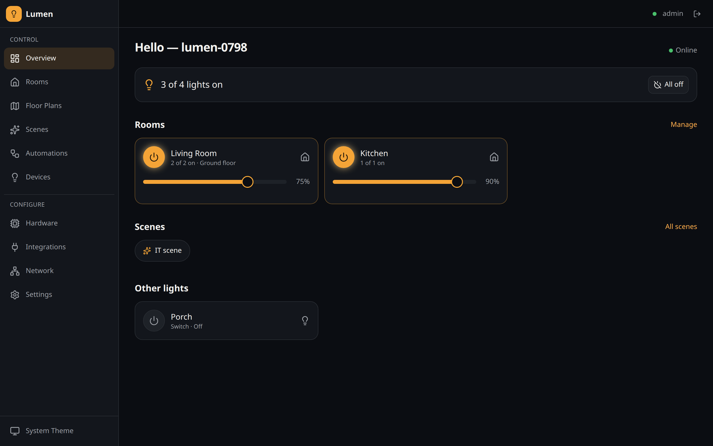
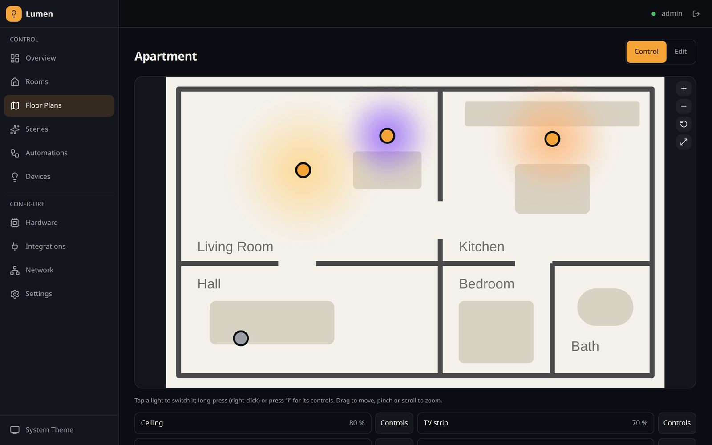
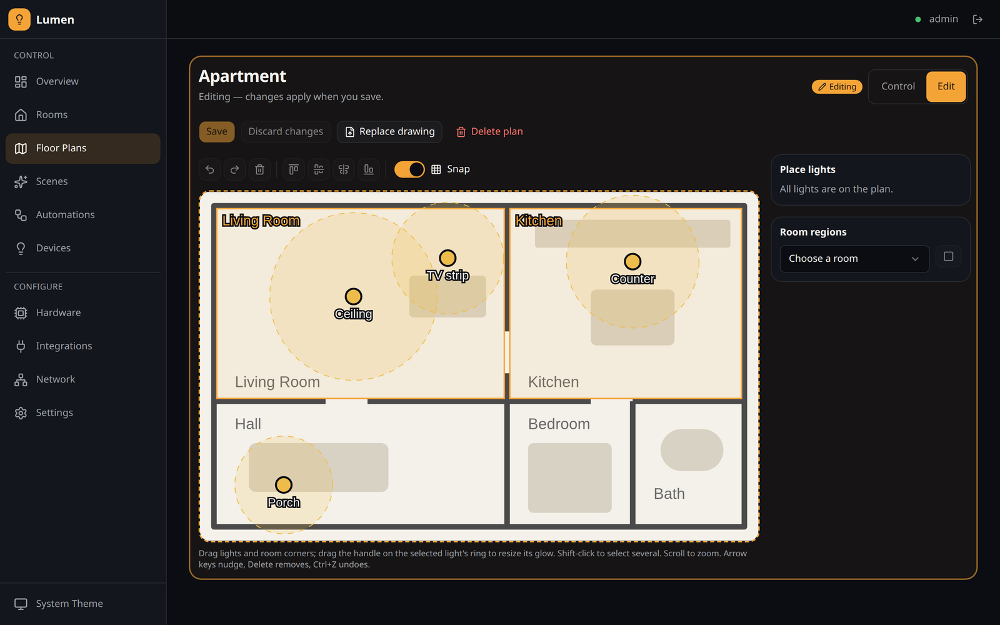
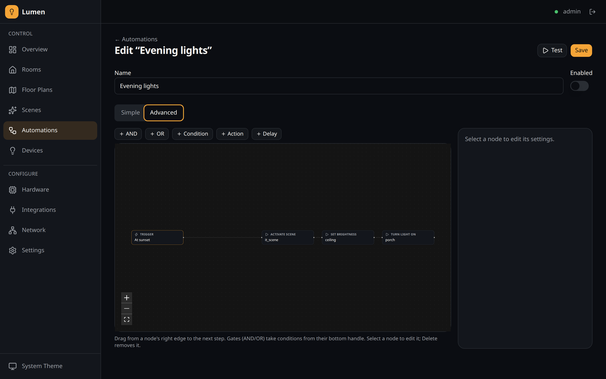
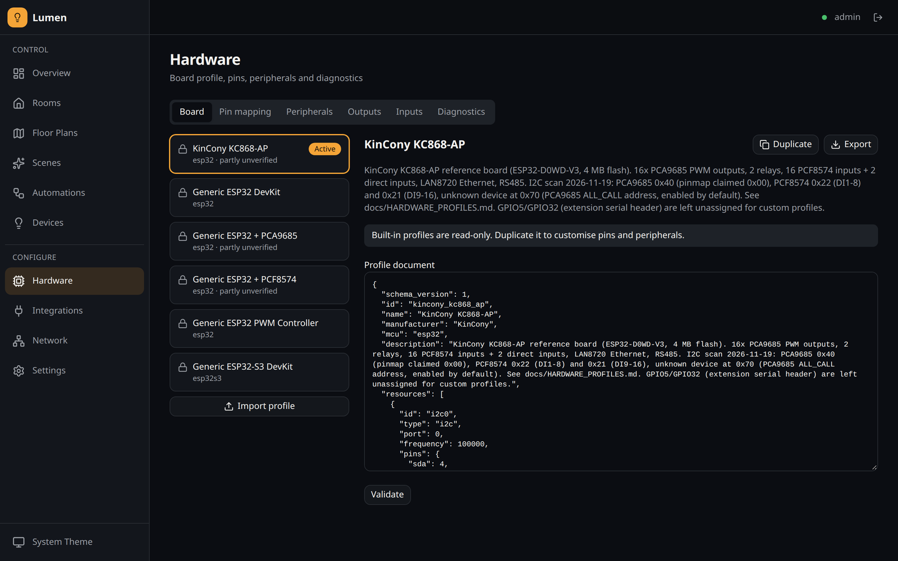
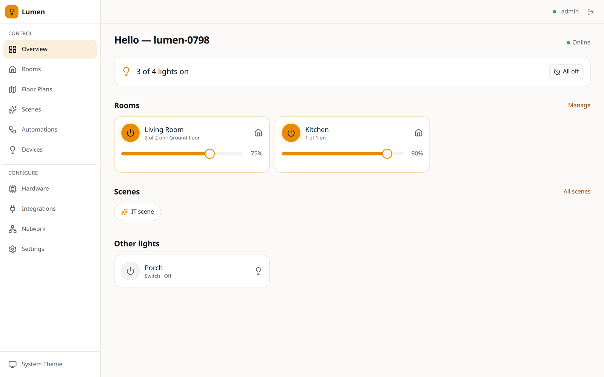
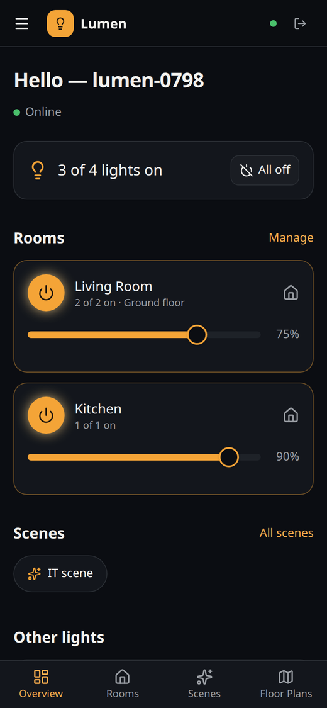
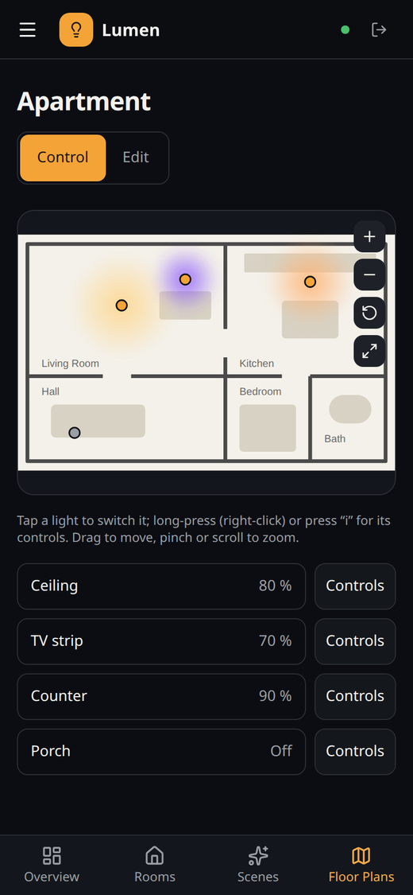
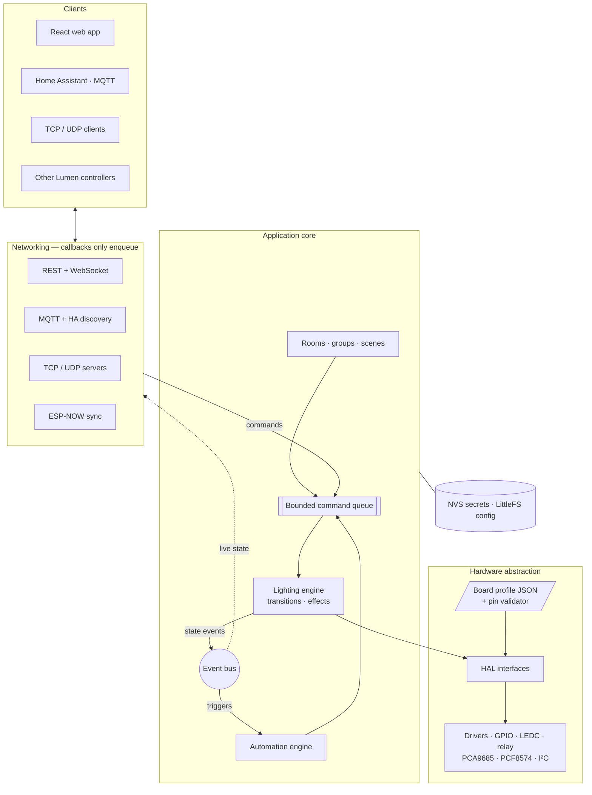

<div align="center">

<picture>
  <source media="(prefers-color-scheme: dark)" srcset="assets/logo-dark.svg">
  
</picture>

### Universal ESP32 smart lighting controller

Firmware and a web app, served from the controller itself. Lights, rooms,
scenes, floor plans and automations all run locally, with no cloud and no
internet needed.

[](https://github.com/charithmadhuranga/Lumen/actions/workflows/ci.yml)
[](https://github.com/charithmadhuranga/Lumen/actions/workflows/release.yml)
[](https://github.com/charithmadhuranga/Lumen/releases)
[](LICENSE)
<br>
[](https://github.com/espressif/esp-idf)
[](https://platformio.org/)
[](#architecture)
[](webui/)
[](webui/)
[](docs/API.md#5-mqtt-and-home-assistant)

[Install](#install) ·
[Features](#features) ·
[Screenshots](#screenshots) ·
[Architecture](#architecture) ·
[Build from source](#build-from-source) ·
[Docs](#documentation)



</div>

---

## Features

| | |
|---|---|
| **Every common light type** | Switch, dimmer, RGB, RGBW and tunable white (CCT). Perceptual dimming, smooth transitions that never block, and 9 effects including candlelight, sunrise and rainbow. |
| **Rooms, groups and scenes** | Control a whole room with one slider. Capture a scene from the current lights and recall it with a fade. |
| **Interactive floor plans** | Upload an SVG of your home and place lights on it. Each light glows with its *actual* output; tap a light to switch it. Includes a full editor with snapping, alignment and undo. |
| **Local automations** | Time, sunrise/sunset, button presses, light state and MQTT triggers, with conditions and actions. Build them in a simple form or a visual node editor. Loop protection is built in. |
| **Home Assistant and MQTT** | MQTT discovery out of the box, with state, commands, groups and scenes over MQTT. Lights keep working when the broker or Wi-Fi is down. |
| **Local control protocols** | REST API, WebSocket live updates, TCP (token-authenticated) and HMAC-signed UDP. |
| **Multiple controllers** | Controllers find each other over ESP-NOW, share light state, control each other's lights and run network-wide scenes. Frames are authenticated, and no router is needed. |
| **Hardware-independent** | Pins live in versioned JSON board profiles that are checked by a pin validator, not in code. Built-in profiles cover the KinCony KC868-AP and generic ESP32/ESP32-S3 boards, and you can create your own in the UI. |
| **Safe updates** | Firmware updates over the network with image checks and automatic rollback, plus web UI updates, a built-in recovery page and transactional backup/restore. |
| **Secure by default** | Forced change of the default password, salted PBKDF2 hashes, CSRF-protected sessions, rate limiting, and secrets kept in NVS only (never in backups or logs). |
| **Works offline** | The web app is fully bundled (485 KB gzipped). It loads no CDN, fonts or tracking, and supports light/dark themes and reduced motion. |

## Screenshots

<table>
  <tr>
    <td width="50%"><br><sub><b>Floor plan, control mode.</b> Each glow follows the light's real output.</sub></td>
    <td width="50%"><br><sub><b>Floor plan editor.</b> Drag lights in from the tray, resize glows and outline rooms.</sub></td>
  </tr>
  <tr>
    <td><br><sub><b>Automations.</b> A visual editor, or the simple form.</sub></td>
    <td><br><sub><b>Hardware.</b> Board profiles, pin map, outputs, inputs, I²C scan and diagnostics.</sub></td>
  </tr>
  <tr>
    <td><br><sub><b>Light theme.</b></sub></td>
    <td align="center"> <br><sub><b>On a phone.</b></sub></td>
  </tr>
</table>

## Supported hardware

| Board | Status |
|---|---|
| **KinCony KC868-AP** (ESP32, 16× PCA9685 PWM, 2 relays, 18 inputs) | Reference board. Every feature is tested on it. Ethernet, RS485 and relay polarity are not yet verified on hardware. |
| Generic ESP32 DevKit | Tested (GPIO and LEDC outputs, ESP-NOW peer). |
| Generic ESP32 + PCA9685 / + PCF8574 / PWM-only | Built-in profiles. |
| Generic ESP32-S3 | Firmware is built in CI but not yet tested on S3 hardware. |

Any ESP32 board with 4 MB flash works with a custom board profile (Hardware → Duplicate → edit pins).
Addressable LED strips (WS2812) are not supported yet.

## Install

Every [GitHub release](https://github.com/charithmadhuranga/Lumen/releases) has ready-to-flash files for each chip.

**New board:** write one file from your browser or the command line.

```sh
pip install esptool
esptool.py --chip esp32 --port /dev/ttyUSB0 --baud 460800 write_flash 0x0 lumen-X.Y.Z-esp32-full.bin
```

You can also flash from Chrome or Edge with no install, using
[esptool-js](https://espressif.github.io/esptool-js/) (address `0x0`).

**First start:** connect to the `Lumen-XXXX` Wi-Fi hotspot. Its password is printed on the serial console at boot.
Then open <http://192.168.4.1>, sign in as `admin` / `admin` and set your own password.
Add your Wi-Fi under **Network**; afterwards the controller is at `http://lumen-xxxx.local`.

**Updating:** use **Settings → Firmware** (`…-app.bin`) and **Settings → Web interface** (`…-web.pack`).
Your settings are kept, and a firmware that fails its health check rolls back by itself.

The full step-by-step guide, with all files, flash addresses and troubleshooting, is
**[docs/FLASHING.md](docs/FLASHING.md)**.

## Architecture

Lighting control does not depend on the network: HTTP, MQTT, WebSocket and ESP-NOW only *enqueue* commands.
A single lighting task owns the hardware. All hardware access goes through HAL interfaces configured from the
board profile, so no GPIO number appears in application code.



| Task | Priority | Role |
|---|---|---|
| `lighting` | 6 (core 1) | 20 ms tick: commands, transitions and effects, a batched PCA9685 flush, input polling, the automation tick |
| `httpd` | 5 | REST API, static web app, WebSocket |
| `ctrl` · `espnow` | 3 | TCP/UDP control; ESP-NOW frames |
| `housekeeping` | 2 | State persistence, MQTT, network supervision |

Every queue is bounded, there are no blocking delays in lighting code, and every Lumen task is watched by the
task watchdog. Persistence is transactional: a failed write never destroys the last working configuration.
For the details, see [docs/ARCHITECTURE.md](docs/ARCHITECTURE.md).

### Repository layout

```text
src/, include/       firmware: core, hardware (HAL + drivers), lighting, automation,
                     networking, web, services
boards/              built-in board profiles (JSON)
schemas/             JSON Schemas for every persisted document
webui/               React app (TypeScript, Vite, Tailwind, shadcn/ui)
test/                host unit tests (test_host_*), device and integration suites
docs/                architecture, API, flashing, hardware, protocols, status
scripts/             build helpers, release packaging
.github/workflows/   CI and the release build
```

## Build from source

Prerequisites: Python 3 with [PlatformIO](https://platformio.org/) 6.2, and Node.js 24.
The toolchain is pinned (`espressif32@8.0.0`, ESP-IDF 6.1.0).

```sh
# Web app → data/web/web.pack (also checks the bundle budgets)
cd webui && npm ci && npm run build:fs && cd ..

# Firmware and file system image
pio run -e esp32                 # or -e esp32s3
pio run -e esp32 -t buildfs

# Flash the board over USB (firmware + file system)
pio run -e esp32 -t upload
pio run -e esp32 -t uploadfs     # first install only: replaces /config too

# Web UI development against a real controller
cd webui && LUMEN_CONTROLLER_URL=http://lumen-xxxx.local npm run dev
```

For development, Wi-Fi credentials can be seeded from a git-ignored `secrets.ini`
(see `scripts/pio_secrets.py`).

### Tests

| Suite | Command |
|---|---|
| Host unit tests (197) | `pio test -e native` |
| Web UI lint, types, unit tests | `cd webui && npm run lint && npm run typecheck && npm test` |
| End-to-end on a real controller (Playwright + axe) | `cd webui && LUMEN_URL=http://<ip> LUMEN_PASSWORD=<pw> npm run test:e2e` |
| Home Assistant / MQTT / TCP / UDP | `cd test/integration/ha && ./setup.sh && python3 ha_test.py http://<ip> '<pw>'` |
| Security, performance, multi-controller, reliability | `test/integration/*.py` (see [AGENTS.md](AGENTS.md#3-commands)) |
| JSON schemas | `npm ci && npm run validate:schemas` |

### Releasing

1. Update `version.txt` and add a section to [CHANGELOG.md](CHANGELOG.md).
2. Tag `v<version>`, then publish a GitHub release for the tag.
3. The [release workflow](.github/workflows/release.yml) runs the checks and builds both chips. It attaches the
   firmware, the merged image, the web pack, per-board zips, checksums and the flashing guide.

## Documentation

| Document | Contents |
|---|---|
| [FLASHING.md](docs/FLASHING.md) | Install, update, recovery, troubleshooting |
| [ARCHITECTURE.md](docs/ARCHITECTURE.md) | Layers, tasks, storage, HAL, updates, floor plans, multi-controller |
| [API.md](docs/API.md) | REST, WebSocket, MQTT/Home Assistant, TCP and UDP protocols |
| [HARDWARE_PROFILES.md](docs/HARDWARE_PROFILES.md) | Board profiles and what is verified on real hardware |
| [AUTOMATION.md](docs/AUTOMATION.md) | Automation model and limits |
| [ESP_NOW_PROTOCOL.md](docs/ESP_NOW_PROTOCOL.md) | Multi-controller protocol |
| [IMPLEMENTATION_STATUS.md](docs/IMPLEMENTATION_STATUS.md) | Feature status, test evidence and known limitations |
| [CHANGELOG.md](CHANGELOG.md) | Release history |

## Project status

**1.0.0-rc.1, release candidate.** All implementation phases are complete and tested on the KC868-AP.
Before 1.0.0, three things remain open: a 24-hour soak test, hardware checks for Ethernet, RS485 and relay polarity, and
ESP32-S3 hardware testing. The full list of known limitations is in the [changelog](CHANGELOG.md).

## Contributing

Issues and pull requests are welcome. Please read [AGENTS.md](AGENTS.md) first: it sets the architecture rules
(no GPIO numbers outside board profiles, enqueue-only network callbacks, bounded queues), the commands and the
definition of done. Every change ships with tests. Hardware claims are marked as verified only after a run on a
real board.

## License

Lumen is released under the [MIT License](LICENSE).

`controller-presets/` holds vendor reference material for the KC868-AP. It is kept for reference only and is
not covered by this license. The logo uses the Lucide "lightbulb" icon ([ISC License](https://lucide.dev/license)).
